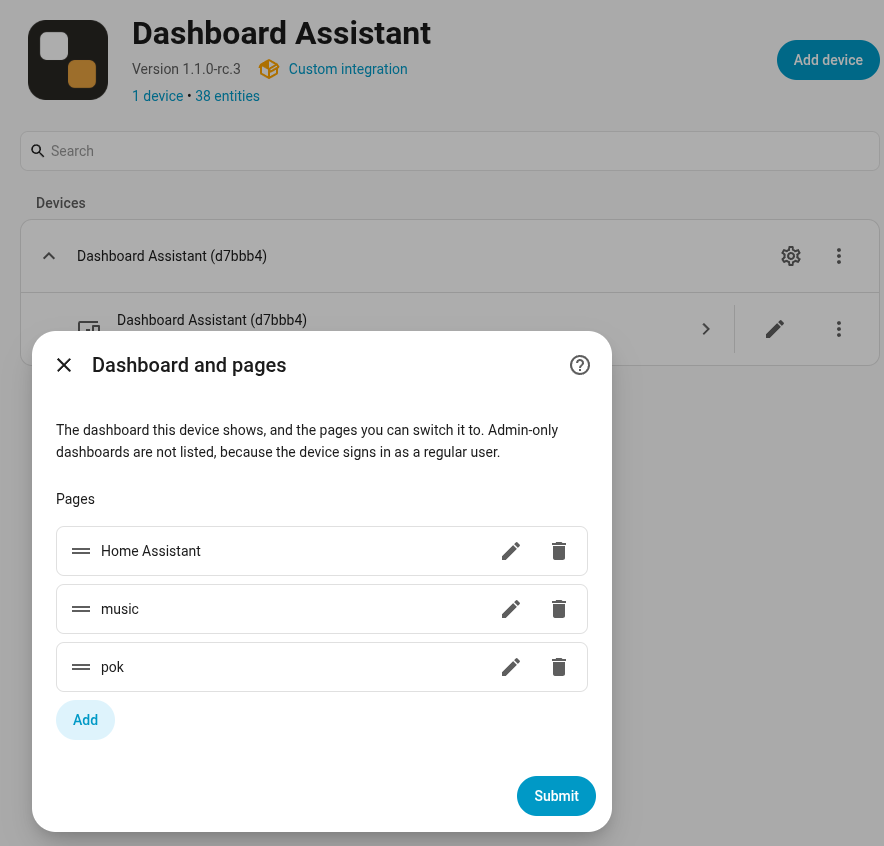

# Dashboard Assistant Integration

A Home Assistant integration for [Dashboard Assistant](https://dashboardassistant.org/) kiosks operating system.
This lets you discover and provision tablets with just one click in Home Assistant.
No complex setups, just a click.

## What you get

The easiest Home Assistant Kiosk setup.
The tablet appears as a Home Assistant device and can be controlled:

- The display is a light. Turn it on/off or dimm.
- Adjust the zoom
- Switch between dark and light mode.
- Configure pages you want to show. Not only Home Assistant, just any URL.
  - allows you to show pages at specifc times
  - or just cycle through them
- Get OS updates via Home Assistant.
- Take a screen shot from the panel.
- Use a screen saver.
- Last touch sensor, when you want to turn off the tablet after the last touch or go back to a specifc screen

## Installation

### 1. Install via Marketplace (formerly known as HACS).

Open it and click **Install**

### Flash the device

Check the Dashboard Assistant OS documentation for that:

https://dashboardassistant.org/getting-started/

### 2. Add the device

Home Assistant **discovers** the device automatically when it joins the network.

You should see it here:

### 3. Join the device

Click **Add**, give it a name and area if needed and then **Add** again.
A sperate user for the Dashboard Assistant will be created and it will log in by itself.

### 4. Configure pages to show on the device

Open the Dashboard Assistant settings:

## Author

This project was created by Andrej Friesen in 2026.

